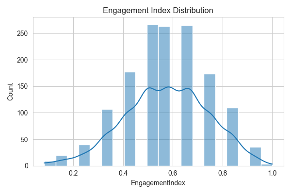
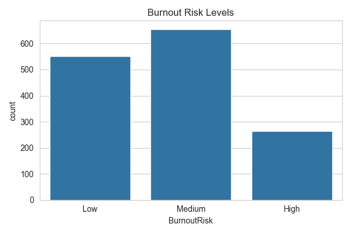
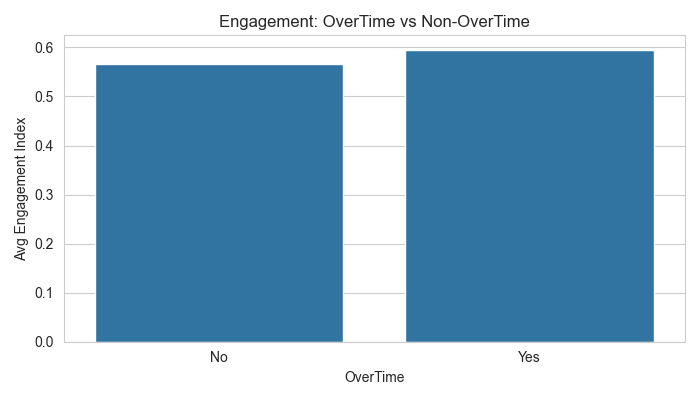
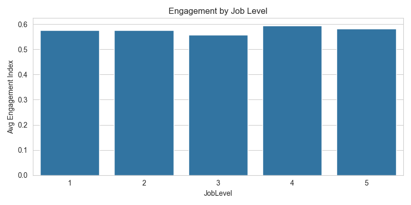

#  Employee Engagement, Satisfaction & Burnout Diagnostic Analysis

An early-warning HR analytics project built for **Palo Alto Networks** as part of the Unified Mentor Machine Learning Fellowship. The project builds a unified **Engagement Index**, flags **burnout-prone employee groups**, and delivers an interactive **Streamlit dashboard** so HR can act *before* employees decide to leave.

🔗 **Live Dashboard:** [https://YOUR-APP-NAME.streamlit.app](https://YOUR-APP-NAME.streamlit.app)

---

## 📌 Problem Statement

Burnout often precedes attrition, but most HR interventions happen after an employee has already decided to leave. The organisation lacked:

- A unified engagement health index
- Visibility into burnout-prone employee groups
- An understanding of how overtime, work-life balance and satisfaction interact

This project provides preventive, data-driven diagnostics instead of reactive attrition analysis.

---

## 📊 Dataset

- **1,470 employees**, **31 features** (demographics, satisfaction scores, workload, tenure, compensation)
- No missing values
- Source file: `Palo Alto Networks.csv`

---

## 🛠️ Methodology

1. **Data validation & normalization** – ordinal scales (1–4) validated and min-max scaled to 0–1.
2. **Engagement Index** – average of normalized `JobInvolvement`, `JobSatisfaction`, `EnvironmentSatisfaction` and `RelationshipSatisfaction`.
3. **Burnout Risk (Low / Medium / High)** – one point each for `OverTime = Yes`, `WorkLifeBalance ≤ 2`, and engagement in the bottom third. Two or more points = High risk.
4. **Workload & career-stage analysis** – engagement compared across overtime, business travel, commute distance, job level and tenure.
5. **Engagement vs attrition** – contextual comparison of employees who stayed vs left.

---

## 🔑 Key Findings

| Metric | Value |
|---|---|
| Org-wide Engagement Index | **0.574** (scale 0–1) |
| High Burnout Risk employees | **264 (18.0%)** |
| Employees working overtime | **28.3%** |
| Average Work-Life Balance | **2.76 / 4** |
| Engagement – employees who stayed | **0.588** |
| Engagement – employees who left | **0.504** |

**Insight:** employees who left had markedly lower engagement than those who stayed, which supports using engagement as an early-warning signal for attrition.

---

## 📈 Charts

| | |
|---|---|
|  |  |
|  |  |

---

## 🖥️ Dashboard Modules

- **Engagement Overview** – organisation-wide score and distribution
- **Burnout Risk Dashboard** – risk levels, overtime impact, list of high-risk employees
- **Role & Career Stage** – engagement by job level and tenure
- **Manager Action Panel** – low-engagement alerts for priority intervention

**Filters:** department, job role, overtime, minimum engagement, tenure range.

---

## 📁 Repository Structure

```
├── eda_analysis.py              # Data cleaning, Engagement Index, Burnout Risk, charts
├── streamlit_app.py             # Interactive dashboard
├── Palo Alto Networks.csv       # Raw dataset
├── outputs/
│   ├── processed_hr_data.csv    # Output of eda_analysis.py (used by dashboard)
│   └── *.png                    # Generated charts
├── requirements.txt
└── README.md
```

---

## 🚀 Run Locally

```bash
pip install -r requirements.txt
python eda_analysis.py
streamlit run streamlit_app.py
```

---

## 🧰 Tech Stack

Python · Pandas · NumPy · Scikit-learn · Matplotlib · Seaborn · Streamlit

---

## 👩‍💻 Author

**Tisha Rakholiya** – Machine Learning Intern, Unified Mentor
